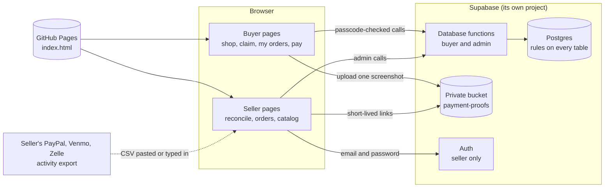
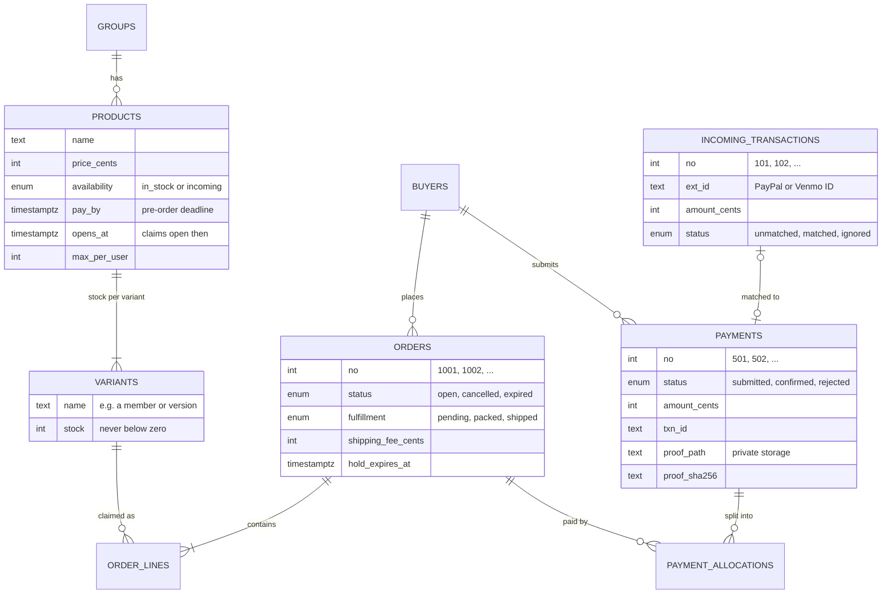
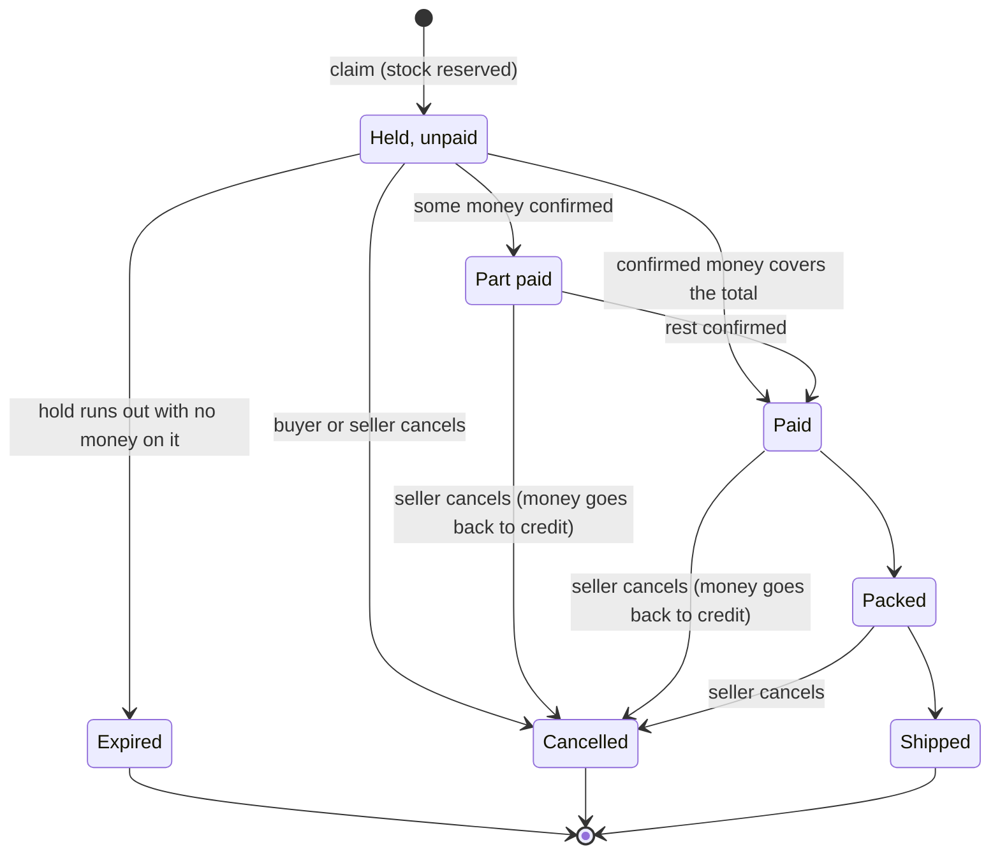
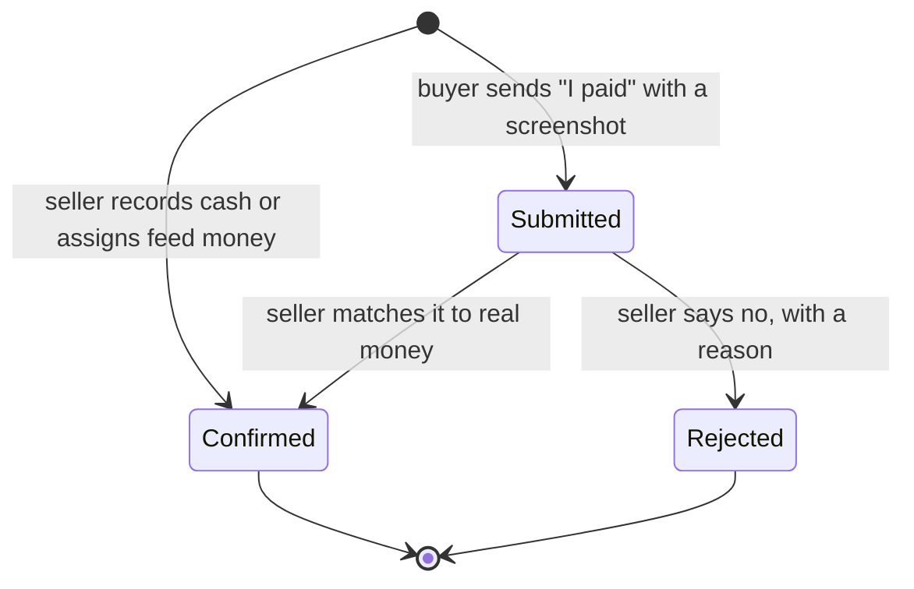
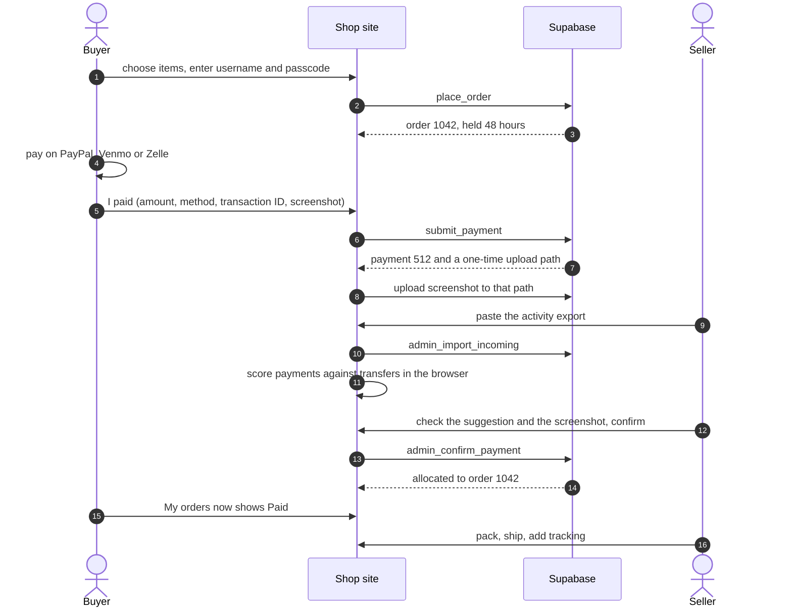

# Shop Manager: design

How a shop works where buyers claim items with their Instagram username, pay by PayPal / Venmo / Zelle, and the seller has to match each payment to real money. This is the structure behind the prototype (`index.html`) and the database (`db/schema.sql`).

## 1. The short version

| Question | Decision | Why |
|---|---|---|
| Who is a buyer? | An Instagram username plus a passcode they make up on their first claim. No email, no account page. | It matches how the shop already runs (people are known by their handle) and costs the buyer nothing. |
| What is a "claim"? | A hold on stock for 48 hours (or until a pay-by date for pre-order items). It is not a payment. | Stock can't be oversold, and unpaid claims release themselves. |
| Is the payment screenshot the proof? | **No. It is evidence.** The proof is the seller's own PayPal / Venmo / Zelle activity. | A screenshot can be edited, re-used, or taken from someone else's payment. Only the seller's account shows what really arrived. |
| So why collect screenshots? | They make the seller's check fast (amount, time, ID and name are visible) and catch obvious mismatches. | They are the cheapest thing a buyer can give, and they are a useful second opinion next to the feed. |
| How is a payment matched? | Three layers: what the buyer says → what the seller's account shows → the seller's click. The app scores likely pairs; **nothing is ever confirmed automatically**. | Money is the one thing that must never be guessed. |
| How is money tracked? | A ledger: payments are split into allocations onto orders. Extra money becomes buyer credit and pays their next claim by itself. | Handles partial payments, one payment for several orders, paying ahead and refunds without special cases. |
| Where does it run? | A static page on GitHub Pages + a free Supabase project (separate from go-manager). | No server to run, no cost to start. |

It is a separate project from go-manager: its own repo, its own database, its own seller login. Nothing is shared, so a mistake here cannot touch go-manager's data. They can link to each other later.

## 2. What I assumed

Please check these; each one is easy to change.

- **Groups** are the artists / K-pop groups (or any theme) you organise the shop by. A group has members (used as variants of a photocard set), and products belong to a group. If "groups" means something else to you (for example group-order batches), the catalog model changes.
- One seller (you). More sellers can be added to the `admins` table, but there are no separate roles.
- US dollars only. Prices are whole cents.
- Payment by PayPal, Venmo and Zelle, with Wise and "other" available but switched off. You send tracking numbers yourself; **shipping addresses are not collected in the app** (there is no address field yet).
- Buyers are told what to do by the page itself; there are no emails or Instagram messages sent automatically.
- The sample data (a made-up group NOVA9, buyers, payments) is fictional.

## 3. Who uses it, and how they are identified

**Buyer** (no login). Identified by `@username` (lower-case, letters / numbers / `.` / `_`, up to 30) and a passcode (4 to 20 visible characters, no spaces), created with the first claim. Five wrong tries lock that username for 15 minutes. The seller can reset a passcode, block a username, or merge a mistyped username into the right one.

**Seller** (Supabase login with email + password). Everything the seller does requires being on the `admins` list; the database refuses everyone else.

How strong is the passcode? It is a speed bump, not a vault. Someone who guesses a passcode can read that buyer's orders and cancel unpaid claims. They **cannot** move money, mark anything paid, or ship anything: only the seller's confirmation does that. That is why money safety lives in the seller's check (section 7) and not in the passcode.

## 4. Data model

| Table | What it holds |
|---|---|
| `groups`, `products`, `variants` | The catalog. A variant is the thing with stock (a member's card, an album version). A product with no real variants has one variant with an empty name. Prices and names are copied onto order lines at claim time, so later edits never change an old order. |
| `buyers` | Username, bcrypt passcode hash, failed-try counter, lock time, blocked flag, a note. The seller can see everything except the hash. |
| `orders`, `order_lines` | One claim = one or more orders (pre-order items with different pay-by dates become separate orders). |
| `payments` | What a buyer says they paid (`submitted`), or money the seller recorded (`confirmed`, source `admin`). |
| `incoming_transactions` | The seller's feed: transfers that really arrived. Added from a pasted export or typed in. |
| `payment_allocations` | **The ledger.** Rows saying "this payment covers this much of this order". |
| `settings`, `activity_log`, `admins` | Shop name and open/closed, hold hours, limits, payment methods; a history of what happened; who the seller is. |

**Numbers are never stored, always worked out**, so they can't drift apart:

- `paid` for an order = allocations from *confirmed* payments
- `pending` = allocations from payments still in review
- `due` = total (items + shipping fee) − paid
- `toSend` = due − pending: what the buyer still has to send, not counting money already waiting for the seller
- **credit** = confirmed payment money not yet allocated to any order

A built-in self-check (`admin_check_books`) lists any order that is overpaid, any payment over-allocated, closed orders still holding money, negative stock, and feed rows "matched" to nothing. It should always return an empty list.

## 5. Lifecycles

Behind the diagram, an order has a `status` (open / cancelled / expired), a `fulfillment` (pending / packed / shipped) and a *derived* pay state (unpaid / partial / paid).

**Holds**

| Rule | Value |
|---|---|
| Normal hold | 48 hours from the claim (a setting, 1 hour to 30 days). |
| Pre-order ("incoming") items | Held until the product's pay-by date. |
| Orders with confirmed money, or a payment waiting for review | Never expire on their own. |
| A payment is rejected | The buyer gets at least 12 more hours to fix it. |
| Seller extends | Any hold can be extended by hours. |
| Expired or cancelled | Stock goes back; confirmed money returns to the buyer's credit and may pay another of their orders. |
| Shipped orders | Can't be cancelled. |

Expiry runs whenever anything happens (a visit, a claim, a seller action), and can also run on a schedule (`pg_cron`, optional).

## 6. "Claim ahead of time": every case

| Situation | What happens |
|---|---|
| **Claim now, pay later** (the normal case) | Stock is held for 48 hours. The buyer sees the countdown. Pay in time, or the hold is released. |
| **Claim an item that hasn't arrived yet** (pre-order) | The product is marked "incoming" with a pay-by date. Claiming reserves a unit until that date. Such lines become their own order, so one deadline never drags another. |
| **A drop that isn't open yet** | The product has an "opens at" time. Before then the page shows when it opens and claims are refused. |
| **Pay before claiming** (pay ahead) | The buyer submits a payment with no order. Once confirmed it sits as **credit**, and the next claim is paid from it automatically, oldest order first. |
| **Pay too much** | The extra stays as credit. |
| **Pay too little** | The order shows "part paid" and what is still due. |
| **One payment for several orders** | The buyer picks the orders; whatever is left goes to their oldest unpaid orders (the seller can switch that off per confirmation). |
| **Several payments for one order** | Fine: allocations add up. |
| **Money arrives that nobody submitted** | It sits in the feed as "received, no buyer yet". The seller assigns it to a username, and the app suggests who (amount equals what they owe, name looks like the handle). |
| **Wrong username typed** | The seller merges the mistyped username into the right one; orders, payments and credit move across. |
| **Shipping fee set later** | The seller sets a fee on an order. If it is lowered below what was paid, the difference goes back to credit. |
| **Cash, or anything outside PayPal / Venmo / Zelle** | The seller records it by hand. |

Worked example: a buyer sends $50 for an $18 order → $18 pays that order, $32 is credit. Later she claims $21.50 → paid from credit at once, $10.50 credit left. Nothing for the seller to click.

## 7. Paying and matching (the heart of it)

### Why a screenshot can't be the proof

A payment screenshot is an image the buyer controls. It can be cropped from someone else's payment, edited, or reused for a second order, and the app can't tell whether the transfer in it ever reached you. So the screenshot is kept as **evidence**, shown next to the real data, and the decision is made against the money that arrived.

### The three layers

1. **What the buyer says.** The "I paid" form: amount, method, transaction ID if there is one, the name on the payment, when, which orders, and a screenshot. It is stored as `submitted`; nothing counts yet. The screenshot is shrunk in the browser (max 1280 px, JPEG) and its SHA-256 is saved so a re-used image can be flagged.
2. **What the seller's account shows.** The seller pastes or uploads the activity export (CSV / TSV) from PayPal, Venmo or the bank. The importer recognises common column names, shows a preview, and skips any row whose transaction ID is already in the feed. Transfers can also be typed in. These rows are the ground truth.
3. **The seller's decision.** The Reconcile screen pairs each submitted payment with the best unmatched transfer, says how sure it is and why, shows the screenshot, and waits. The amount that arrives in the feed wins over the amount the buyer typed.

### How pairs are scored

| Signal | Points |
|---|---|
| Transaction ID equal (6+ letters/digits, same method) | +60 |
| Amount equal | +30 (or +10 if within the tolerance, default $1.00) |
| Time apart: within 6 h / 2 days / a week | +10 / +6 / +2 |
| Sender name: matches / looks similar / partly | +10 / +6 / +3 |

Pairs only form between the same method. Each transfer can be used once (best score first). Result per payment:

| Level | Meaning | What the seller does |
|---|---|---|
| **exact** | Transaction ID and amount both match | Can be confirmed in bulk ("Confirm N exact matches"). |
| **check** | ID matches, amount differs | Look: short payment, fee, or a typo. |
| **likely** | Amount matches, within 2 days, nothing else competes, and close in time or the name looks right | Glance at the screenshot, confirm. |
| **possible** | Plausible, but two payments or transfers look alike, or the evidence is thin | Compare carefully. |
| **none** | No transfer fits | Wait for the money, ask the buyer, or reject. |

Two pairings less than 8 points apart count as ambiguous and are never "likely". Nothing is confirmed without a click.

### Flags shown next to a payment

Same transaction ID as another payment · identical screenshot to another payment · less than what the chosen orders need · more than needed (becomes credit) · selected orders already paid · no screenshot attached.

Confirmation is refused if the transaction ID was already confirmed on another payment (the database enforces this too), or if the transfer was already used. Confirming without a feed row needs an explicit "I checked my account", which is recorded.

### Per method

- **PayPal and Venmo**: the buyer can copy a transaction ID, and the activity export contains it. These reach "exact".
- **Zelle**: the prototype assumes there is no ID that looks the same on both sides, so Zelle matches on amount + time + sender name and tops out at "likely". Check your bank statement for these.
- **Cash / other**: recorded by hand.

### Other ways to do it, and why not

| Option | Verdict |
|---|---|
| Screenshot only | Faked or reused too easily. Kept as evidence. |
| Buyer types the transaction ID | Strongest signal when present; not reliable alone (forgotten, mistyped, none for Zelle). Used. |
| Reference code in the payment note | Exact when followed, but many buyers forget and platforms may discourage notes. Possible add-on. |
| Unique cents ($18.07) | Annoying for buyers and breaks with fees. No. |
| **Import the seller's activity (chosen)** | Ground truth. Costs a minute a day. |
| Reading the screenshot with OCR | Could pre-fill the form; still not proof. Roadmap, assist only. |
| Payment API with webhooks (Stripe, PayPal checkout) | Fully automatic, but fees, setup, and buyers leave Friends & Family. Worth it only if volume grows. |

## 8. Screens

**Buyer** (`#/shop`, `#/checkout`, `#/orders`, `#/pay`, `#/rules`)

- **Shop**: groups as filters, products as tiles (sold out and "opens soon" are shown, not hidden), claim bar at the bottom.
- **Claim**: items, username, passcode (first time: choose one), total, hold time.
- **My orders**: credit / owed / in review at a glance, each order with its countdown, pay state, tracking; payments sent and their status; cancel an unpaid claim.
- **Pay**: pick orders, amount (pre-filled with what is still owed, minus money already in review), method with the seller's handle, transaction ID, name, time, screenshot. Also "add credit ahead of time".
- **How it works**: the rules in plain words.

**Seller** (`#/seller` to sign in, then `#/admin/...`). Nothing links to the seller area. A visitor who types `#/admin` is sent back to the shop and sees no sign-in box; the door is `#/seller` (bookmark it). In the live shop it is a real email + password login, and the database enforces the rest: every seller function checks the `admins` list.

- **Overview**: on an empty shop, a short "start here" list (settings, first group and products, share the link). Otherwise: counts that need action (payments to review, money with no buyer, holds ending soon, ready to pack / ship, owed, credit, low stock).
- **Reconcile**: the matching screen above; add or import received money; assign money with no buyer.
- **Orders**: filter, pack / ship with tracking, shipping fee, extend hold, cancel.
- **Catalog**: groups, products, variants and stock, pre-order and opening dates, per-person limits, hide / delete.
- **Buyers**: who owes what, credit, passcode status, reset, block, merge.
- **Settings**: shop name, open / closed, hold hours, amount tolerance, limits, payment methods and handles, require screenshot, and **Look of the shop** (main colour, tagline, announcement banner). A backup download. In the demo build only: time travel and reset.

**The look.** The shop's colour is one value (`accent_color`, sky blue `#96d6f0` by default). `Core.themeFrom` turns it into the whole set (button fill, hover, pale tint, link colour, text on the fill, page background tint) and guarantees WCAG AA contrast for any colour the seller picks (tested on 3,000 random colours). The colour is applied for every visitor from `shop_info()`; changing it in Settings previews instantly and saves with the rest. Fonts, spacing and layout live in `src/style.css` (variables at the top).

A normal day: import the PayPal / Venmo export → bulk-confirm exact matches → look at likely / possible ones with the screenshot → assign any money nobody claimed → pack and ship the paid orders.

## 9. Backend contract

The prototype's fake backend (`src/api.js`) and the real database expose the same calls. Times are epoch milliseconds, money is integer cents, and results are JSON shaped like the prototype's.

**Buyer** (callable by anyone; each checks the passcode itself)

| Function | Inputs | Returns |
|---|---|---|
| `shop_info()` | none | The whole storefront in one call: `now`, shop name and look (`accentColor`, `tagline`, `notice`), open / closed, hold hours, require-screenshot, enabled payment methods, and the catalog (`groups`, `products`, `variants`: only what is on sale, with live stock). It releases lapsed holds first, so the counts are right even if nobody has touched the shop for days. |
| `buyer_status(username)` | username | `{exists, blocked}` |
| `my_account(username, passcode)` | | orders (with `paid / due / pending / toSend / payState / leftMs`), payments (with `hasProof`, never the file), `creditCents`, `dueCents`, `pendingCents`, `toSendCents` |
| `place_order(username, passcode, lines)` | `lines = [{variantId, qty}]` | `{orderIds, creditAppliedCents}`; the first claim creates the passcode |
| `submit_payment(username, passcode, payment)` | `{method, amountCents, txnId?, senderName?, paidAt?, orderIds?, proof?: {sha256, name, ext}}` | `{paymentId, no, proofPath}`; the browser then uploads the image to `proofPath` |
| `cancel_my_order(username, passcode, orderId)` | | `{refundedToCreditCents, reappliedCents}` |

A passcode problem comes back as `{ok: false, code, message}` with code `wrong_passcode`, `locked` or `no_passcode` (returned, not raised, so the failed-try counter is saved). Any other problem is an error whose hint is the code below.

The catalog is also readable straight from the tables (the policies show only active groups, products on sale and live variants), but the page uses `shop_info()`.

**Seller** (signed in and listed in `admins`)

| Function | What it does |
|---|---|
| `admin_snapshot(closed_days = 60)` | Everything the seller screens need in one call, in the prototype's own shape (so the screens and the matcher in the browser are reused). Releases lapsed holds first. |
| `admin_confirm_payment(payment, incoming?, amount?, manual_verified, auto_apply)` | Confirm against a feed row, or with "I checked my account". Returns `{allocated, creditCents, amountCents}`. |
| `admin_reject_payment(payment, reason)` | Reject; the buyer's holds get 12 h of grace. |
| `admin_import_incoming(items)` / `admin_ignore_incoming(id, ignore)` | Add to the feed (duplicates skipped) / hide a row. |
| `admin_assign_incoming(incoming, username, order_ids, auto_apply)` | Give unclaimed money to a buyer. |
| `admin_record_payment(username, method, amount, note, order_ids, auto_apply)` | Cash and other hand-recorded money. |
| `admin_cancel_order`, `admin_set_fulfillment(order, to, tracking)`, `admin_set_shipping_fee(order, cents)`, `admin_extend_hold(order, hours)` | Order handling. Pack / ship need a fully paid order. |
| `admin_merge_buyer(from, to)`, `admin_reset_passcode`, `admin_set_blocked` | Buyer handling. |
| `admin_save_group`, `admin_save_product`, `admin_delete_product` | Catalog. Variants that were sold are archived; others are deleted. A product with orders can only be hidden. |
| `admin_save_settings(patch)` | Any subset of: `shopName`, `shopOpen`, `holdHours`, `requireProof`, `nearTolCents`, `maxOpenUnpaidOrders`, `maxPendingPayments`, `accentColor`, `tagline`, `notice`, `methods`. Out-of-range values are refused and nothing is half-saved. |
| `release_expired_holds()`, `admin_check_books()` | Housekeeping and the self-check. |

**Every seller action first releases lapsed holds**, then runs, and either fully applies or changes nothing.

**Error codes**: `bad_username`, `bad_passcode`, `closed`, `blocked`, `empty`, `bad_qty`, `unavailable`, `not_open`, `oversold`, `limit`, `too_many`, `need_proof`, `bad_method`, `bad_amount`, `bad_time`, `too_many_pending`, `bad_order`, `txn_used`, `not_found`, `bad_state`, `has_money`, `shipped`, `unpaid`, `verify_required`, `incoming_taken`, `in_use`, `bad_input`, `forbidden`.

**Limits**: price up to $5,000; stock up to 999,999; 99 of one item and 60 lines per claim; one payment up to $2,000; shipping fee up to $500; hold 1 hour to 30 days; payment time not in the future and not older than 60 days; at most 8 unpaid orders and 3 payments in review per buyer (settings).

**How the page connects.** `config.js` holds `supabaseUrl` and `supabaseAnonKey`. When both are set, `src/live.js` replaces the browser-only backend with plain `fetch` calls (no library): `POST /rest/v1/rpc/<function>` with named arguments, `/auth/v1/token` for the seller's email + password (the session is refreshed automatically and kept in the browser), and `/storage/v1/object/payment-proofs/<path>` for screenshots (the path comes from `submit_payment`; up to 3 tries). Visitors' state comes from `shop_info()`; the seller's from `admin_snapshot()`, reloaded after every seller action; screenshots are shown through short-lived signed links. Error replies are turned into the same errors the screens already show (`hint` is the code). If `config.js` is empty the page runs the private preview instead, with a banner saying nothing is shared. If `config.js` contains a *secret* key (service role / `sb_secret_`), the page refuses to run and says so.

## 10. Security and privacy

- **Tables are closed.** Logged-out visitors can only read the catalog. Buyer data is reachable only through the six buyer functions, which check the passcode inside the database. The seller's tables are readable only by users in `admins`. Passcode hashes can't be read by anyone, including the seller.
- **Screenshots** go to a private bucket: images only, 2 MB max. A buyer can write one file, once, to the exact random path their payment was given, within 30 minutes, and can never read or list anything. Only the seller can view or delete them.
- **No secrets in the repo.** The anon key is public by design. The `service_role` key is never used. Keep sign-ups off and use a strong password (and two-factor) on the seller login.
- **Text from buyers is always escaped** before it is shown, and image links are checked before use.
- **The matcher runs in the seller's browser**, not in the database, so it can change without touching the database.

Known risks and what to do about them:

| Risk | Note |
|---|---|
| Someone claims popular items under made-up usernames just to hoard stock | Holds expire in 48 h, limits per person and 8 unpaid orders per username apply, and the seller can block. Not stopped outright. Next steps if it happens: shorter hold for usernames with no paid order, a cap on total unpaid holds, or a bot check on claim. |
| Someone locks a victim out by failing their passcode on purpose | The lock lasts 15 minutes; the seller can reset. |
| Anyone can ask whether a username has an account | Needed to show "create passcode" vs "enter passcode". Low impact. |
| Screenshots contain personal details | Keep them only as long as needed; delete old ones through the Storage API or dashboard (SQL deletes leave the files behind). |
| Seller account takeover | The one high-impact risk: use a long unique password and two-factor. |

## 11. Hosting and cost

GitHub Pages serves `index.html` (free). Supabase's free plan runs the database and storage; at the time of writing it is about 500 MB of database and 1 GB of files, and it pauses a project after a week without activity, which is what `keepalive.yml` prevents. Check current limits on supabase.com/pricing. A compressed screenshot is roughly 100 to 250 KB, so 1 GB holds thousands. The free plan has no automatic backups, so export your data regularly.

## 12. What was checked

- **Rules** (`tests/core.test.mjs`, 40 tests, including the colour guarantees): claims, oversell, holds and expiry, credit, partial and over payments, rejections and grace, shipping-fee changes, cancellation refunds, merging, matching and scoring, feed parsing, passcode rules.
- **Database** (`tests/db.test.mjs`, 66 tests on a real Postgres): who can see or do what as a logged-out visitor, a logged-in stranger and the seller; every buyer and seller function and error code; the lockout surviving failed calls; screenshot upload rules; running the schema twice. Plus **12 random shops of 160 actions** run through both the database and the prototype's rules, comparing orders, payments, allocations, the feed, stock, credit and each buyer's view after every action (24 extra shops of 200 actions also matched during development). I checked the comparison has teeth: five deliberately broken versions of the SQL were each caught.
- **Live mode in a browser** (during development, not shipped): the real page against a stand-in for Supabase that runs `db/schema.sql` in a real Postgres and speaks the same HTTP shapes (RPC, auth, storage, CORS from another origin). A stranger sees an empty shop and no trace of the seller; wrong password and a login that is not on the `admins` list are refused; the seller adds a group and a product, restyles the shop and a second visitor sees it; claim, pay with a screenshot (one failed upload is retried; a final failure is reported honestly), the seller sees the screenshot through a signed link and confirms; sign-out, a login the server forgot, automatic token refresh, outages.
- **Browser** (during development, not shipped): the full happy path, 13 edge scenarios (lockout, expiry via time travel, stock changes, hostile text in names, feed import, reload and persistence), and an accessibility scan with no violations on every screen.
- **Not verified**: the page against a real Supabase project (the stand-in follows Supabase's documented shapes, but real CORS headers, the new publishable-key format and multipart uploads can differ in small ways: the README's check list catches that on day one); two people racing for the last item on a real server (designed with row locks, but the test database has one user, so test it); the web fonts (blocked in my environment, so only the fallback fonts were seen).

## 13. Limits and next steps

Limits today: until `config.js` is filled in, the page is a private preview (nothing shared between devices); the seller screens load the last 60 days of closed orders (the backup download has everything); no shipping addresses; no automatic messages; one currency; shipped orders stay in the list forever (the seller snapshot will need an archive once history is large).

Next, in order: **1** go through the README checklist on the real project · **2** collect shipping addresses and print labels · **3** copy-ready message templates for DMs (pay reminder, shipped) · **4** a "delete screenshots older than N days" button · **5** claim protection (bot check, shorter holds for new usernames) · **6** OCR to pre-fill the payment form · **7** payment webhooks if volume justifies it.

## 14. Questions for you

1. Does "groups" mean artists / K-pop groups, or something else (group-order batches, fandoms)?
2. By "claim ahead of time", did you mean claiming before paying, claiming items not in stock yet (pre-orders), a scheduled opening time, or all of these? All are built; I can drop the ones you don't need.
3. How do you collect shipping addresses today, and should the app?
4. Which payment methods do you actually use, and are Zelle payments common (they need the most manual checking)?
5. Is 48 hours the right hold, and do pre-order items have fixed pay-by dates?
